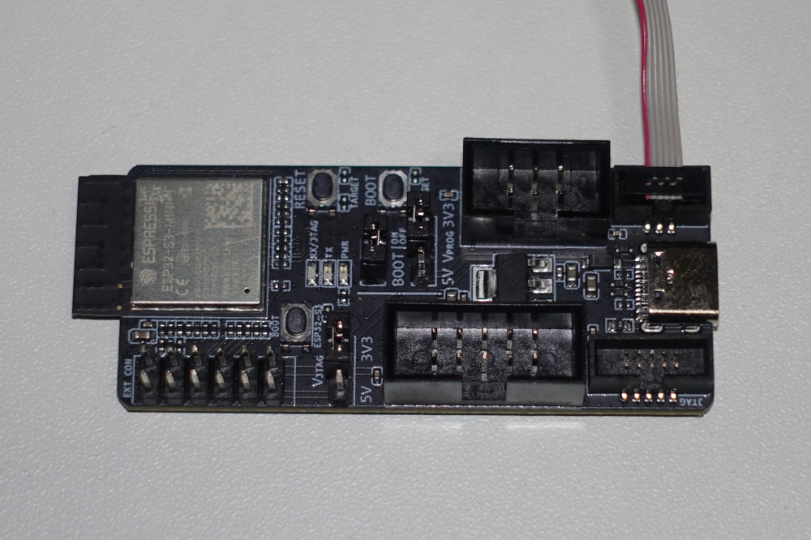

# Litter Robot 4 - Firmware Flashing Guide

This guide covers replacing the stock ESP32 firmware on the Litter Robot 4 mainboard with custom ESPHome firmware. The process is fully reversible and you can restore the original firmware at any time. After ESPHome is on the device, future updates can be delivered wirelessly ([OTA](#updating-the-firmware-ota)).

Feel free to join the [Discord server](https://discord.gg/NrMdSAkPsx) for assistance or discussion, before and after install!

> Disclaimer: This project is not affiliated with, endorsed by, or associated with Whisker, Litter Robot, or Automated Pet Care Products. Modifying your device involves hardware disassembly and modification which may void your warranty and carries a risk of permanent damage. Proceed at your own risk. Neither the author(s) nor contributors are responsible for any damage to your device, property, or pets resulting from the use of this firmware or instructions.

## Mainboard Revision Notice

There are 2 known major revisions of the Litter Robot 4 mainboard. Both will work, but preparing the mainboard for flashing is slightly different. Older units have a serial number starting with "LR4C", and newer units manufactured after February 2026 have a serial number starting with "LR4S". Take note of which one you have before purchasing any hardware.

> For serial numbers starting with "LR4C", stock firmware should be updated to 1175.5021.292 (July 2024) or later prior to install, otherwise the litter hopper accessory will not function.

---

## Recommended Hardware

- [**ESP-Prog-2 development board**](https://amzn.to/4vMhlyv) (affiliate link) - Includes a 1.27mm pitch ribbon cable not mentioned in the listing

- **[Fine fiberglass brush](https://amzn.to/4iqF6Je)** (affiliate link) or **razor blade** - Any sharp object to scratch off conformal coating

- **Phillips-head screwdriver**

- **USB-C cable**

### For serial numbers starting with "LR4C":

- **Soldering iron** (fine/curved tip) and solder

- [**1.27mm (0.05") pitch 2x3 6 position surface-mount header**](https://www.ebay.com/itm/336714254669) (sold directly by me in the US) - Also available from [DigiKey](https://www.digikey.com/en/products/detail/sullins-connector-solutions/GRPB032VWQS-RC/1786412) globally.

### For serial numbers starting with "LR4S":

#### Option 1 - Solderless:

- [**2.54mm (0.1") Single Row 5 Pin Test Clip**](https://amzn.to/4djYzIc) (affiliate link) - Includes jumper wire

#### Option 2 - Soldered:

- **Soldering iron** (fine/curved tip) and solder

- [**2.54mm (0.1") pitch single row 5 position through-hole header**](https://www.digikey.com/en/products/detail/wurth-elektronik/61300511121/4846831)

- [**Female to female jumper wire**](https://www.digikey.com/en/products/detail/adafruit-industries-llc/1950/6827084)

## Software

- **esptool** - Install instructions can be found [here](https://docs.espressif.com/projects/esptool/en/latest/esp32/installation.html). If you're allergic to the terminal or command prompt you may be able to find a GUI alternative for your OS.

- **Pre-compiled firmware binary** - download the `.bin` from the latest [LR4 release](https://codeberg.org/Joseph-DiGiovanni/esphome-litter-robot/releases?q=LR4%2F).

  - *Alternatively*, you can compile it from source using `litter-robot4.yaml`:

  ```bash
  esphome compile /path/to/litter-robot4.yaml
  ```

  The compiled binary will be in `./.esphome/build/litter-robot4/build/firmware.factory.bin` relative to the `.yaml` file.

---

## Accessing the Mainboard

You can follow [Whisker's official video guide for replacing the laser board](https://www.youtube.com/watch?v=m9pkoDCwM14) up to the part where you disconnect the laser board (stop at 1:56), otherwise expand the steps below:

<details>
<summary>Step by step instructions</summary>
<br>

1. **Prepare the unit.** Make sure the globe is in the home position. Press the Power button to turn the unit off, then unplug it from the wall. Remove any accessories.

2. **Remove the bonnet.** Press and hold the latches on both sides of the bonnet, then lift and rotate it to its open position. Remove the bonnet completely.

3. **Remove the globe.** Grab the black handle on top of the globe and lift it off the base. Set it aside.

4. **Remove the waste drawer.** Pull it out and set aside.

5. **Place the unit face-down.** Position the unit face-down on the bezel on a solid flat surface.

6. **Remove the bottom screws.** Remove the 10 screws from the black bridge (the plastic structure the bezel attaches to).

7. **Remove the bezel screws.** Remove the 4 screws located behind the seal strips attached to the bezel (these are along the top edge as the unit sits face-down).

8. **Separate the bezel.** With a hand in the drawer opening of the base, tip the unit slightly. Carefully pull out one side of the bezel to begin separating it from the bridge, then pull the other side and remove the bezel completely.

9. **Unplug the laser board.** The laser board is at the top center of the unit. The mainboard is positioned just to the right of it, underneath the control panel. Gently pull out the laser board connector on the left side of the mainboard.

</details>

## Remove the Mainboard

Unplug the larger power connector on the right side of the mainboard. Remove the 2 screws securing the mainboard and control panel to the bridge right below the control panel. The mainboard can now be removed with the control panel attached.


---

## Preparing the Mainboard

> The following directions assume the mainboard is oriented with the control panel facing up with the LED indicators facing you as they do normally, and the ESP-Prog-2 with the pins facing you and the USB-C port on the right side.

To connect the ESP-Prog-2 to the mainboard to backup/flash the firmware, follow the instructions based on the serial number of your Litter Robot:

<details>
<summary>For serial numbers starting with "LR4C"</summary>
<br>

Plug the included 6 pin ribbon cable into the top right header on the ESP-Prog-2. It should be keyed to only plug in one way, with pin 1 (indicated by a pink wire) on the left side.



The mainboard has an unpopulated 6-pad footprint on the left side next to the ESP32 for the ESP-Prog header, it is labeled "J3". You will need to scrape off the thin layer of conformal coating on it before soldering. A fine fiberglass brush is ideal for this, but you can do it gently with a razor blade or other sharp object. Just be careful not to cut any traces.


You now have two options:

- Solder the 1.27mm pitch 6 pin surface mount header to the unpopulated pads. (Recommended)

	

- Solder the wires directly between the ESP-Prog-2 and the mainboard. If both boards are in the orientation stated above, the pinout will match exactly. The top left pin/pad does not need to be connected. The pins of the large and small 6 pin connectors on the ESP-Prog-2 are electrically identical.

	

The mainboard must be powered externally to read/write the flash of the ESP32. It's easiest to just put it back in the Litter Robot at this point. Make sure the ESP-Prog-2 is properly and securely connected. Double check the ribbon cable is centered and oriented properly on the mainboard since it isn't keyed. Resecure the mainboard with screws and plug the laser board and power cable back in.


</details>

<details>
<summary>For serial numbers starting with "LR4S"</summary>
<br>

The mainboard has 5 unpopulated through-hole pads on the left side next to the ESP32, it is labeled "J3". You will need to scrape off the thin layer of conformal coating on them to make electrical contact. A fine fiberglass brush is ideal for this, but you can do it gently with a razor blade or other sharp object. Just be careful not to cut any traces.


You have two options:

- **Solderless:** Clip the 5 pin test clip onto the pads. The clip may have screws on the lower jaw, make sure they don't short anything out. You can cover them with tape if necessary.

> Please submit a photo of the test clip attached to the mainboard for use here in this guide, either via an issue on Codeberg or [Discord](https://discord.gg/NrMdSAkPsx)!

- **Soldered:** Solder the 2.54mm pitch 5 pin header and connect the ESP-Prog-2 with jumper wires:

    

    or solder wires directly from the ESP-Prog-2 to the mainboard.

Either way you will have to follow this diagram when connecting the wires:


> You can optionally connect 3.3v to the first square pad of J7 to power the mainboard and flash the firmware outside of the unit. **Make sure the ESP-Prog-2 "VPROG" jumper is set to 3.3v first. Do not connect this pin when installed in the Litter Robot.**

The pins of the large and small 6 pin connectors on the ESP-Prog-2 are electrically identical.

The mainboard must be powered externally to read/write the flash of the ESP32. It's easiest to just put it back in the Litter Robot at this point. Make sure the ESP-Prog-2 is properly and securely connected. Resecure the mainboard with screws and plug the laser board and power cable back in.

> Thank you [@ghulands](https://codeberg.org/ghulands) for testing and photos
</details>

---

## Backing Up the Stock Firmware

Before overwriting anything, make a full backup of the stock firmware. With the mainboard connected to the ESP-Prog-2 and the programmer plugged into your computer follow along in terminal or command prompt:

Determine the correct serial port:

> check /dev/ttyACM* on Linux, COM* on Windows, /dev/cu.usbserial-* on macOS

```bash
ls /dev/ttyACM*
```

We will assume /dev/ttyACM0 for the rest of the instruction.

Make sure the computer can communicate with the ESP32:

```bash
esptool --port /dev/ttyACM0 flash-id
```

If you get permission errors you may need to add your user to the `dialout` group and log out, or just take ownership with:

```bash
sudo chown $USER /dev/ttyACM0
```

You should see information about the ESP32, including the flash size. Mine is 8MB, so we'll be sure to back up all of it:

```bash
esptool --port /dev/ttyACM0 --baud 921600 read_flash 0x0 0x800000 LR4_stock_firmware_backup.bin
```

> If you encounter communication errors, try lowering the baud rate (e.g., `--baud 460800` or `--baud 115200`)

If all went well you should have a ~8MB file called `LR4_stock_firmware_backup.bin` in the current directory.

**Keep this backup file safe.** You'll need it if you ever want to restore the original firmware.

---

## Flashing the ESPHome Firmware

Now that the backup is complete, erase the full flash:

```bash
esptool --port /dev/ttyACM0 --baud 921600 erase_flash
```

Write the ESPHome firmware starting at address 0x0:

```bash
esptool --port /dev/ttyACM0 --baud 921600 write_flash 0x0 /path/to/firmware.bin
```

> Be sure to use the `.bin` file and not `.ota`.

A successful flash will end with output similar to:

```
Hash of data verified.
Leaving...
Hard resetting via RTS pin...
```

---

## First Boot & Setup

On first boot, the ESPHome firmware will start in **WiFi access point mode** with a captive portal:

1. Connect to the WiFi network `litter-robot4-XXXXXX` (password: `Wh1sk3rM30wM30w`).

2. A captive portal should appear. If it doesn't, navigate to `http://192.168.4.1` in a browser.

3. Select your home WiFi network and enter its password. The LR4 will reboot and connect to your network.

### Reassembly

Now that you've verified the new firmware is working, you can once again follow [Whisker's official video guide for replacing the laser board](https://youtu.be/m9pkoDCwM14?t=128) from 2:08 to reassemble, or just follow the disassembly instructions in reverse.

### Adding to Home Assistant

The device should be auto-discovered by the ESPHome integration. If it doesn't appear, add it manually with the device's hostname or IP address.

> The hostname is usually the same name as the access point earlier. You can find the hostname or IP in your router device list.

All entities will now be available in Home Assistant. Some may be disabled by default to avoid cluttering your dashboard. You can enable them in the device page.


#### Sleep Schedules

Independent sleep schedules for every day of the week are supported. Each day has three entities:

- A day-enable switch (e.g. "Sunday Sleep Schedule") that turns that day's schedule on or off.
- A sleep time and a wake time (e.g. "Sunday Sleep Time" and "Sunday Wake Time").

Enable the days you want to schedule and set their sleep and wake times. The schedule runs on the mainboard's real-time clock, which is kept in sync with local time from Home Assistant.

#### Multi-Cat Tracking

The precompiled firmware includes weight and visit-count entities for four cats. To track a cat:

1. Enable the needed cat's weight and visit entities.
2. Rename each cat's weight and visit entities with the desired names.
3. Set each cat's weight number entity to your best guess.

The firmware matches each new weight reading to the nearest configured cat weight and increments that cat's visit counter, eventually replacing all user input weights with a real weight measurement. There is a 0.6 pound detection tolerance to avoid obviously false readings by default. Use a cat's reset button (e.g. **Cat 1 Tracker Reset**) to clear that cat's stored weight and counters (the Litter Robot's own Factory Reset does not clear the tracker data).

### Web Server

The default configuration hosts a web server from the device IP address. The default username is `user` and the password is `Wh1sk3rM30wM30w`.

### Adopting in ESPHome Dashboard

The configuration can be "adopted" into [ESPHome Device Builder](https://desktop.esphome.io/) for further configuration. It should automatically show up at the top of the dashboard in a "Discovered Devices" tab. The auto-generated config imports the `litter-robot4.yaml` from this repository as a base package.

---

## Updating the Firmware (OTA)

Once ESPHome is installed, future firmware updates can be applied over the air without reopening the unit. This process is automated in the ESPHome Device Builder dashboard, but you can also update via the web server:

1. Download the latest OTA update file (`.ota`) from the latest [LR4 release](https://codeberg.org/Joseph-DiGiovanni/esphome-litter-robot/releases?q=LR4%2F).

2. Open the device's web interface using the hostname or IP of the device in a browser. The default username is `user` and the password is `Wh1sk3rM30wM30w`.

3. At the bottom, use the "OTA Update" file selector to select the downloaded OTA update file and click update. Be sure to not use the `.bin` file or the update will fail.

---

## Restoring the Stock Firmware

To return the LR4 to its original state, flash the backup you made earlier:

```bash
esptool --port /dev/ttyACM0 --baud 921600 write_flash 0x0 /path/to/LR4_stock_firmware_backup.bin
```

The unit will reboot with the original firmware and reconnect to the WiFi and Whisker cloud if it was previously.
